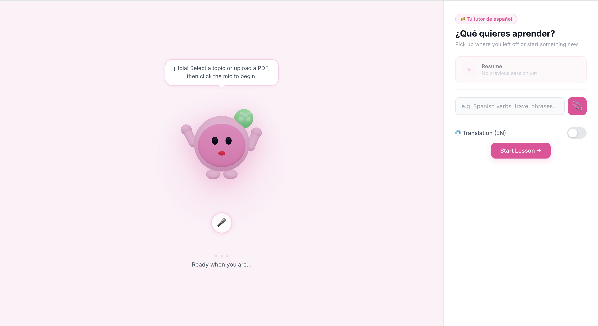
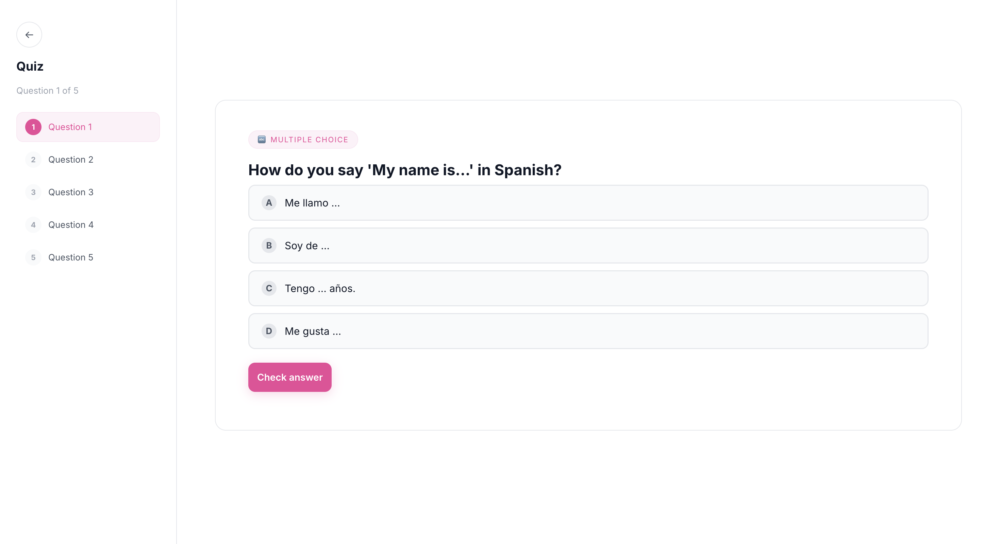

# Hi Hola Annyong 👋

**AI-powered language-learning assistant** for practicing Spanish through
spoken conversation, lessons, and quizzes. This is a
local-first prototype; speech and language models run on your machine.

## 01. About the project

Language learners often need a low-pressure way to practice speaking, not just
memorize vocabulary. Hi Hola Annyong is an experimental Spanish tutor that
combines conversational practice with learning activities. It is intended for learners
who want to explore an AI-assisted practice workflow on their own computer.

## 02. Features

- Start a Spanish lesson from a topic or an uploaded PDF.
- Speak with the tutor using your microphone.
- See conversation captions and hear synthesized tutor responses.
- Generate and evaluate quizzes, including from session topic or book chapters.
- Save sessions and vocabulary in a local SQLite database.

Features and model quality are still under active development; see
[Limitations and roadmap](#11-limitations-and-roadmap).

## 03. Demo




## 04. Architecture

The React/Vite interface sends requests to a FastAPI backend. During
voice conversations, the browser records speech and converts it to WAV; the
backend coordinates transcription, tutor responses, speech synthesis, and
session persistence. Local Ollama serves the language model, while audio
processing uses its respective model libraries.

```text
Browser (React + Vite)
  ├─ microphone audio → FastAPI
  └─ captions and generated audio ← FastAPI
                                  ├─ tutor and lesson logic
                                  ├─ speech / pronunciation pipeline
                                  ├─ Ollama (Qwen)
                                  └─ SQLite (sessions and vocabulary)
```

The Vite development server proxies `/api` requests to the backend at
`http://localhost:8000`.

## 05. Technology stack

- **Backend:** Python 3.12+, FastAPI, Pydantic, Uvicorn
- **Speech recognition:** Faster-Whisper
- **Speech synthesis:** Kokoro
- **Language model:** Ollama with `qwen2.5:7b`
- **Audio and phoneme processing:** Transformers, CNAM Spanish phonemizer,
  phonemizer, FFmpeg, eSpeak NG, and PortAudio
- **Persistence:** SQLite
- **Frontend:** React, Vite, Three.js, and React Three Fiber
- **Development:** `uv`, pytest, and Ruff

## 06. Getting started

You will need Python 3.12, [`uv`](https://docs.astral.sh/uv/), Node.js with npm,
Ollama, and platform-specific audio dependencies. Follow
[`docs/setup.md`](docs/setup.md) for installation instructions for macOS,
Linux, and Windows.

Install the Python dependencies and prepare the local language model:

```bash
uv sync --locked
ollama pull qwen2.5:7b
```

Make sure Ollama is running before starting a lesson. It may run as a
background service; otherwise start it in a separate terminal with
`ollama serve`.

## 07. Usage

Start the backend:

```bash
uv run uvicorn api:app --reload
```

In another terminal, install the UI dependencies and start Vite:

```bash
cd ui
npm ci
npm run dev
```

Open the local URL printed by Vite (normally `http://localhost:5173`). Choose a
topic or upload a PDF, start a lesson, and allow microphone access for voice
practice. The backend API and interactive API documentation are available at
`http://localhost:8000` and `http://localhost:8000/docs`.

## 08. Project structure

| Path | Purpose |
| --- | --- |
| `api.py` | FastAPI application and HTTP endpoints |
| `tutor/` | Conversation and lesson logic |
| `audio/` | Audio processing pipeline |
| `pronunciation/` | Phonemization and alignment |
| `books/` | PDF ingestion and quiz generation |
| `memory/` | SQLite persistence |
| `interfaces.py` | Interfaces for speech and language-model adapters |
| `model_diagnostics/` | Manual diagnostics and model demos |
| `tests/` | Python tests and audio fixtures |
| `ui/` | React/Vite browser application |
| `docs/` | Platform setup and development notes |

## 09. Testing and CI

Run the Python tests and lint locally:

```bash
uv run pytest -q
uv run ruff check .
```

GitHub Actions runs the Python test suite on pushes and pull requests using
Python 3.12. CI installs system audio dependencies but does not download or run
the speech and language models. Real-model diagnostics are documented in
[`docs/setup.md`](docs/setup.md).

## 10. Contributing

Contributions and bug reports are welcome. Before opening a pull request,
please:

1. Check existing issues and pull requests for related work.
2. Keep changes focused and add or update tests for behavior changes.
3. Run the relevant Python checks and, for UI changes, build the frontend.
4. Describe the change, how you tested it, and any setup or model requirements
   in the pull request. Include screenshots for visible UI changes when
   available.
5. For bugs, include reproduction steps and relevant error output. Do not include
   secrets, personal recordings, downloaded model files, or local database files
   in issues or commits.

## 11. Limitations and roadmap

- This is a prototype focused on Spanish and is not a substitute for a human
  language teacher.
- Real speech and language features depend on locally installed system
  dependencies and downloaded models; performance depends on your hardware.
- The project is still evolving, and model-backed workflows are not exercised
  by CI.
- No published roadmap is available yet. Feature plans and current work should
  be tracked in the repository's issues.

## 12. License and acknowledgements

Project-authored code is licensed under the [GNU Affero General Public License
v3.0 or later](LICENSE). Third-party libraries, model weights, and system tools
retain their own terms; see [THIRD_PARTY_LICENSES.md](THIRD_PARTY_LICENSES.md).

Thanks to the maintainers and contributors of the libraries, models, and tools
that make this project possible.
